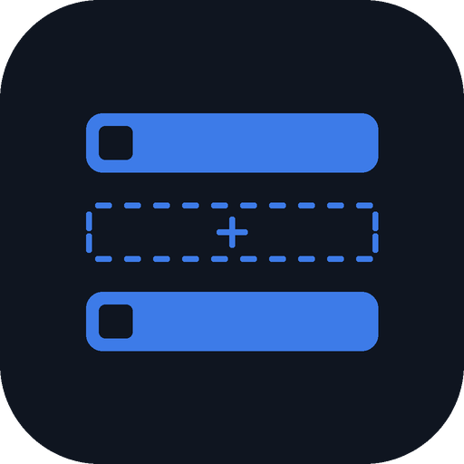

<p align="center">
  
</p>

<h1 align="center">PlexGaps</h1>

PlexGaps scans your Plex library and shows two lists:

- **Missing episodes** for every series, grouped by season.
- **Missing movies** from every franchise, for example the rest of a trilogy.

It runs as one Docker container with a small web UI. Results are cached and the library is rescanned on a schedule. Everything is configured from the web UI.

## Contents

- [How it works](#how-it-works)
- [Install on Unraid](#install-on-unraid)
- [First-time setup](#first-time-setup)
- [Using the web UI](#using-the-web-ui)
- [Settings reference](#settings-reference)
- [Running without Unraid](#running-without-unraid)
- [Troubleshooting](#troubleshooting)
- [Limitations](#limitations)
- [Development](#development)

## How it works

1. PlexGaps reads your TV and movie libraries from Plex and the TMDB, TVDB or IMDb ids Plex stores for each item.
2. **TV:** for each series it asks TMDB for the full episode list of every season and compares it with the episodes Plex has. Specials and unaired episodes are skipped unless you turn them on.
3. **Movies:** for each movie it asks TMDB which collection (franchise) the movie belongs to, then lists the other films in that collection that you do not own. Unreleased films are skipped unless you turn them on.
4. Results are saved to `/config/results.json` and shown in the UI.

PlexGaps only reads from Plex. It never changes your library.

## Install on Unraid

### From the template repository

1. In Unraid open the **Docker** tab settings and add this line to **Template repositories**:

   ```
   https://github.com/RayMunro/HackerHog
   ```

2. On the **Docker** tab choose **Add Container**, select **PlexGaps** from the template list and click **Apply**.
3. Open the WebUI from the container's menu, or go to `http://YOUR-SERVER-IP:8686`.

### Building the image yourself

```bash
docker build -t plexgaps .
docker run -d --name plexgaps --restart unless-stopped \
  -p 8686:8686 -v /mnt/user/appdata/plexgaps:/config plexgaps
```

If you build under a different image name, change the **Repository** field in the container settings to match.

## First-time setup

You need two things:

- **Plex token.** In Plex Web open any item, choose **Get Info**, then **View XML**. The token is the `X-Plex-Token=` value in the address bar.
- **TMDB API key.** Create a free account at themoviedb.org, then open **Settings, API**. Either the "API Key" or the long "API Read Access Token" works.

Then:

1. Open the web UI. With nothing configured it opens on the **Settings** tab.
2. Enter the Plex URL (for example `http://192.168.1.10:32400`), the Plex token and the TMDB key.
3. Click **Test connection**. Plex and TMDB are checked separately and your libraries appear as checkboxes.
4. Untick any library you do not want scanned. Leaving all ticked scans every library.
5. Click **Save and scan**.

Secrets are stored in `/config/settings.json` (readable only by the container user) and are never sent back to the browser. Leave a secret field blank to keep the saved value.

## Using the web UI

| Control | What it does |
|---|---|
| Missing episodes | Series with gaps, with a count per season. Expand a season to see each missing episode and its air date. |
| Missing movies | Franchises with gaps, listing the missing films and the ones you own. |
| Filter | Narrows the current list by title. |
| Ignore | Hides a series or franchise you do not care about. Tick **show ignored** to see it again and **Unignore** it. |
| Scan now | Starts a scan immediately. Progress shows in the header. |
| Settings | Connection, libraries and scan options. |

Items that could not be matched on TMDB are listed at the bottom of each tab. Fixing the match in Plex (Fix Match) and rescanning clears them.

## Settings reference

All options can be set on the Settings tab. Environment variables are optional and only provide the starting values. Anything saved in the UI takes priority.

| Setting | Environment variable | Default | Meaning |
|---|---|---|---|
| Plex URL | `PLEX_URL` | | Plex server address |
| Plex token | `PLEX_TOKEN` | | Plex token |
| TMDB key | `TMDB_API_KEY` | | TMDB v3 key or v4 read access token |
| TV libraries | `PLEX_TV_LIBRARIES` | all | Comma separated library names |
| Movie libraries | `PLEX_MOVIE_LIBRARIES` | all | Comma separated library names |
| Scan interval | `SCAN_INTERVAL_HOURS` | 24 | Hours between scans, 0 for manual only |
| Include specials | `INCLUDE_SPECIALS` | false | Count season 0 as missing |
| Include unreleased | `INCLUDE_UNAIRED` | false | List episodes and movies not yet released |
| Data folder | `DATA_DIR` | `/config` | Where settings and results are stored |

The container exposes port `8686` and stores its data in `/config`.

## Running without Unraid

Any Docker host works:

```bash
docker run -d --name plexgaps --restart unless-stopped \
  -p 8686:8686 -v plexgaps-config:/config ghcr.io/raymunro/plexgaps:latest
```

## Troubleshooting

| Symptom | Fix |
|---|---|
| Red banner `401 Unauthorized` from Plex | The Plex token is wrong or expired. Get a fresh one and save it. |
| Red banner `TMDB returned 401` | The TMDB key is wrong. Use the v3 API key or the read access token. |
| Test connection hangs or fails to connect | Check the Plex URL and port. From another container use the server IP, not `localhost`. |
| Series listed as unmatched | Plex has no TMDB, TVDB or IMDb id for it. Use **Fix Match** in Plex, then rescan. |
| Episodes reported missing that you have | The show is ordered differently in Plex than on TMDB (common for anime). Use **Ignore**. |
| A franchise you expect is missing | TMDB does not group those films into a collection. |
| Nothing changes after fixing Plex | Click **Scan now**. Scans otherwise run on the interval. |

View the container log for details:

```bash
docker logs plexgaps
```

## Limitations

- Episode numbering follows TMDB.
- Franchises come from TMDB collections only.
- Only libraries of type TV and Movie are scanned.

## Development

```bash
python3 -m venv .venv
.venv/bin/pip install -r requirements.txt pytest
.venv/bin/python -m pytest
DATA_DIR=./data .venv/bin/uvicorn app.main:app --port 8686
```

Layout:

| Path | Purpose |
|---|---|
| `app/plex.py` | Plex API client and id parsing |
| `app/tmdb.py` | TMDB client with caching and rate limit handling |
| `app/scanner.py` | Gap detection for series and franchises |
| `app/main.py` | Web API, settings storage and scheduler |
| `app/static/index.html` | Web UI |
| `tests/` | Unit tests with fake Plex and TMDB |

Pushing to `main` runs the tests and publishes `ghcr.io/raymunro/plexgaps:latest` for amd64 and arm64. Pushing a tag such as `v1.0.0` also publishes versioned tags. After the first publish, set the package visibility to **Public** in the GitHub package settings so Unraid can pull it.

The Unraid template lives in the [HackerHog](https://github.com/RayMunro/HackerHog) repository (`templates/plexgaps.xml`), and the project is licensed GPL-3.0-or-later.
